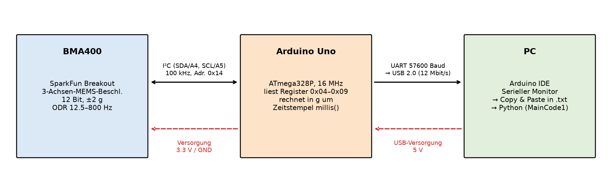
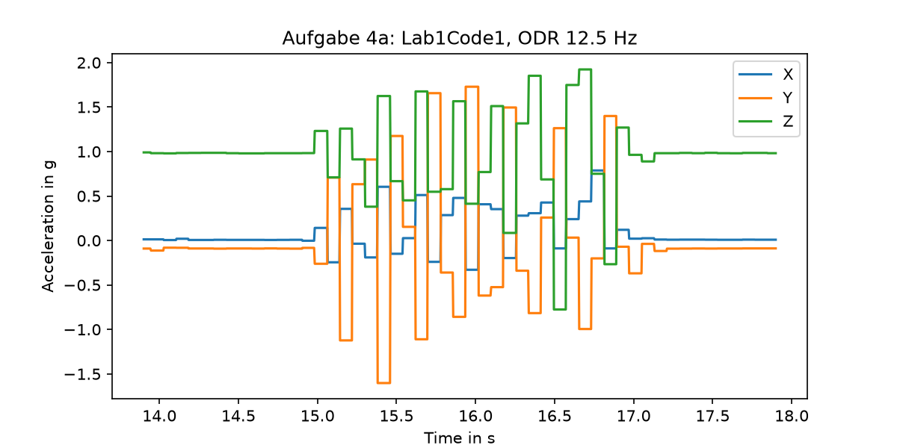
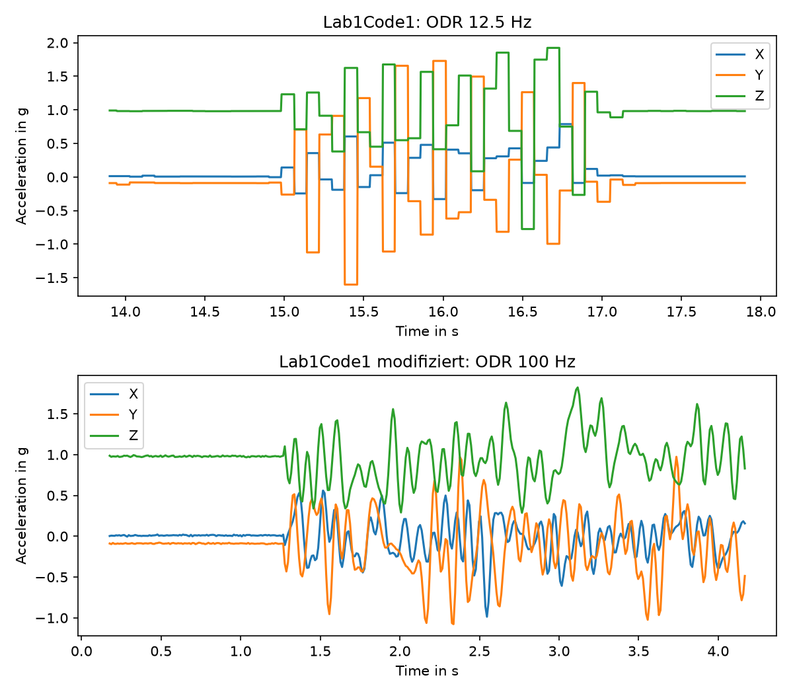
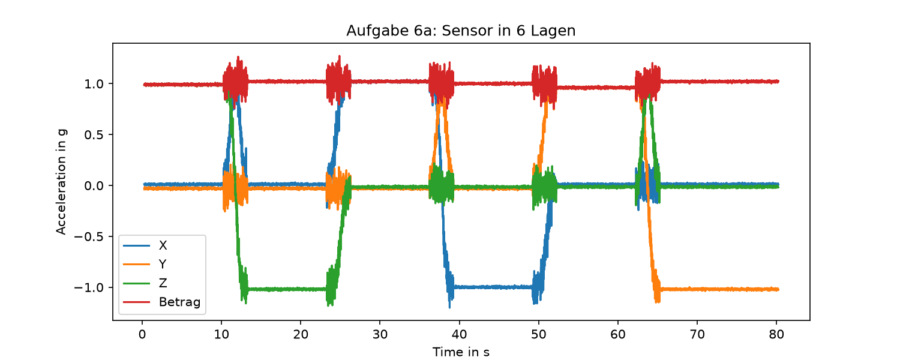
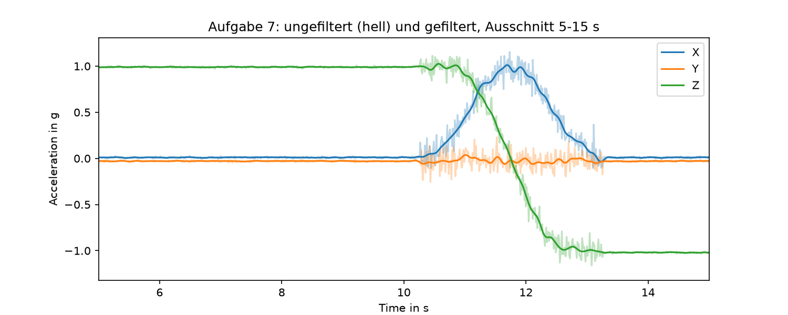
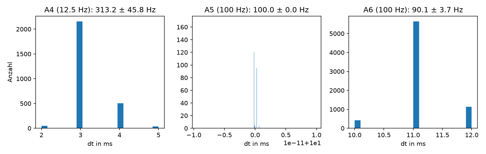

# Laborbericht 1 – Biosignalverarbeitung

**Gruppe X** · Namen: … · Datum: …

---

## Aufgabe 1: Messsystem

*Abbildung 1: Aufbau des Messsystems. Schwarz: Daten, rot gestrichelt: Versorgung.*

- **BMA400:** 3-Achsen-Beschleunigungssensor (MEMS) mit 12 Bit. Messbereich und Abtastrate (ODR) lassen sich einstellen. Die Messwerte stehen in den Registern 0x04–0x09.
- **I²C-Bus:** 2-Draht-Bus (SDA = A4, SCL = A5) mit 100 kHz. Der Arduino ist Master, der Sensor Slave mit der Adresse 0x14.
- **Arduino Uno:** Stellt den Sensor ein, liest die Werte aus, rechnet sie in g um und hängt den Zeitstempel `millis()` an. Er versorgt den Sensor mit 3,3 V.
- **UART/USB:** Der Arduino sendet die Daten seriell mit 57600 Baud, ein Wandler auf dem Board setzt das auf USB um. Über USB bekommt der Arduino auch seine 5 V.
- **PC:** Im seriellen Monitor der Arduino-IDE werden die Daten angezeigt, per Copy & Paste in eine .txt-Datei kopiert und dann in Python ausgewertet.

---

## Aufgabe 2: Temperatur aus ADC-Wert

ADC-Wert in Spannung (10 Bit, 0–1023, Referenz 5 V):

$$U = 520 \cdot \frac{5\,\text{V}}{1023} \approx 2{,}54\,\text{V}$$

Spannung in Temperatur (linear, 0–3,3 V entsprechen 0–40 °C):

$$T = 2{,}54\,\text{V} \cdot \frac{40\,°\text{C}}{3{,}3\,\text{V}} \approx 30{,}8\,°\text{C}$$

Der Sensor misst also **ca. 30,8 °C**. Das passt für eine Messung auf der Haut. Weil der Sensor höchstens 3,3 V liefert, nutzt man nur ADC-Werte bis ca. 675 und verschenkt dadurch Auflösung.

---

## Aufgabe 3: Achsen und Umrechnung

Lab1Code1 gibt pro Zeile `X Y Z Time` aus. **Test:** Man legt den Sensor so hin, dass eine Achse nach oben zeigt. Diese Achse zeigt dann ca. 1 g an, die anderen ca. 0. Flach auf dem Tisch (z nach oben) haben wir z. B. `7 −91 1002` gemessen, also z ≈ 1 g.

**Einheit:** Ausgegeben werden Rohwerte (LSB), 12 Bit im Zweierkomplement (−2048 … 2047).

**Umrechnung:** Laut Datenblatt gilt bei ±2 g eine Empfindlichkeit von 1024 LSB/g:

$$a\,[\text{m/s}^2] = \frac{\text{raw}}{1024} \cdot 9{,}81$$

Beispiel: 1002 / 1024 = 0,98 g = 9,60 m/s².

---

## Aufgabe 4: Erstes Experiment (Lab1Code1, ODR 12,5 Hz)

### (a) Plot

*Abbildung 2: 4 s der Messung mit Lab1Code1, umgerechnet in g.*

### (b) Plateaus

Jeder Wert bleibt ca. 80 ms gleich. Der Sensor misst nur mit 12,5 Hz, die `loop()` gibt aber ohne `delay` ca. alle 3 ms (≈ 313 Hz) eine Zeile aus. Bis ein neuer Wert da ist, wird immer wieder derselbe Wert gelesen. **Lösung:** ODR erhöhen (siehe Aufgabe 5) und die Ausgabe mit `delay` an die ODR anpassen.

### (c) Warum passen die Daten nicht zur Bewegung?

Bei 12,5 Hz liegt die Nyquist-Frequenz bei 6,25 Hz. Die schnelle Bewegung hat höhere Frequenzanteile, deshalb entsteht **Aliasing**: Pro Bewegung gibt es nur wenige Messpunkte, und das Signal springt hin und her, statt die Bewegung zu zeigen. Außerdem misst der Sensor immer auch die Erdbeschleunigung mit. Wenn sich die Hand leicht dreht, verteilt sich diese auf die Achsen.

---

## Aufgabe 5: Abtastrate erhöhen

**Datenblatt:** BMA400, **S. 64**, Register **`ACC_CONFIG1` (0x1A)**, Parameter **`acc_odr`** (Bits 3:0).

| `acc_odr` | 0x00–0x04 | 0x05 | 0x06 | 0x07 | 0x08 | 0x09 | 0x0A | 0x0B | 0x0C–0x0F |
|---|---|---|---|---|---|---|---|---|---|
| ODR | reserviert | 12,5 Hz | 25 Hz | 50 Hz | **100 Hz** | 200 Hz | 400 Hz | 800 Hz | reserviert |

**Änderung im Code:** `accel.setODR(BMA400_ODR_100HZ)` und `delay(10)` in der `loop()`.

**Warum 100 Hz:** Handbewegungen liegen deutlich unter 50 Hz (Nyquist-Frequenz bei 100 Hz) und werden damit ohne Aliasing erfasst. Mehr ist nicht sinnvoll, weil die serielle Schnittstelle mit 57600 Baud bei 200 Hz an ihre Grenze käme.

*Abbildung 3: Vergleich je 4 s: oben ODR 12,5 Hz, unten ODR 100 Hz.*

**Vergleich:** Gleich ist der Ruhepegel (Z ≈ 1 g, X und Y ≈ 0) und die Größe der Ausschläge (bis ca. 1,8 g). Anders ist, dass es bei 100 Hz keine Treppenstufen mehr gibt. Die Kurve ist glatt und die einzelnen Auf-ab-Bewegungen sind als Schwingung zu erkennen. Bei 12,5 Hz ist das Signal durch das Aliasing zerhackt. Der Grund ist nur die höhere Abtastrate, Sensor und Messbereich sind gleich geblieben.

---

## Aufgabe 6: Zeitstempel und 6 Lagen

Jede Zeile bekommt auf dem Arduino den Zeitstempel `millis()` (4. Spalte). Die mittlere Abtastfrequenz steht in Aufgabe 8.

### (a) Plot

*Abbildung 4: Sensor in 6 Lagen à 10 s, rot der Betrag |a|.*

### (b) Ergeben die Daten Sinn?

| Lage | X [g] | Y [g] | Z [g] | \|a\| [g] |
|---|---|---|---|---|
| Z oben | 0,01 | −0,03 | **0,99** | 0,99 |
| Z unten | 0,01 | −0,03 | **−1,02** | 1,02 |
| X oben | **1,02** | −0,03 | −0,02 | 1,02 |
| X unten | **−1,00** | −0,03 | −0,02 | 1,00 |
| Y oben | 0,01 | **0,96** | −0,02 | 0,96 |
| Y unten | 0,01 | **−1,02** | −0,02 | 1,02 |

Ja. Die Achse, die senkrecht steht, zeigt immer ca. ±1 g, die anderen ca. 0, und der Betrag ist immer ca. 1 g. Zeigt eine Achse nach oben, ist der Wert positiv, weil der Sensor die Gegenkraft der Unterlage misst. Die kleinen Abweichungen (bis 0,04 g) kommen von Offset-Fehlern des Sensors und davon, dass er nicht ganz gerade lag.

---

## Aufgabe 7: Filter

*Abbildung 5: Ungefiltert (hell) und gefiltert, Ausschnitt 5–15 s.*

Wir haben einen Butterworth-Tiefpass 4. Ordnung mit 5 Hz genommen und ihn mit `filtfilt` angewendet. Der Filter entfernt das Rauschen und das Zittern der Hand (in Ruhe sinkt die Standardabweichung von Z von 6,0 auf 1,6 mg). Die Lagewechsel bleiben erhalten, und durch `filtfilt` gibt es keine Phasenverschiebung. Einen Tiefpass haben wir genommen, weil die Lage sich nur langsam ändert, das Rauschen aber hochfrequent ist.

---

## Aufgabe 8: Abtastfrequenz

*Abbildung 6: Histogramme der Abtastintervalle Δt.*

Berechnet aus den `millis()`-Zeitstempeln: $f_s = 1/\overline{\Delta t}$, Abweichung $\sigma_{f_s} \approx \sigma_{\Delta t}/\overline{\Delta t}^{\,2}$.

| Messung | $\overline{\Delta t}$ [ms] | $\sigma_{\Delta t}$ [ms] | $f_s$ [Hz] |
|---|---|---|---|
| A4: Lab1Code1 (ODR 12,5 Hz) | 3,19 | 0,47 | 313 ± 46 |
| A5: modifiziert (ODR 100 Hz) | 10,00 | 0,00 | 100,0 ± 0,0 |
| A6: 6 Lagen (ODR 100 Hz) | 11,10 | 0,46 | 90,1 ± 3,7 |

Bei Lab1Code1 gibt die Schleife mit ca. 313 Hz aus, weil es kein `delay` gibt. Neue Sensorwerte kommen aber nur mit 12,5 Hz. Mit dem geänderten Code passen Ausgabe und ODR zusammen, die Abtastfrequenz liegt bei ca. 100 Hz. Sie kann etwas darunter liegen, weil zu `delay(10)` noch das Auslesen über I²C und `Serial.print` dazukommen. Weil `millis()` nur auf 1 ms genau ist, wäre `micros()` genauer.

---

## Aufgabe 10: Code

Abgegeben werden `MainCode1.ipynb` (Aufgaben 4a, 5, 6, 7, 8), die Datensätze im Ordner `data/` und `Lab1Code1_modifiziert.ino`. Das Notebook läuft komplett durch und speichert die Abbildungen in `figures/`.
